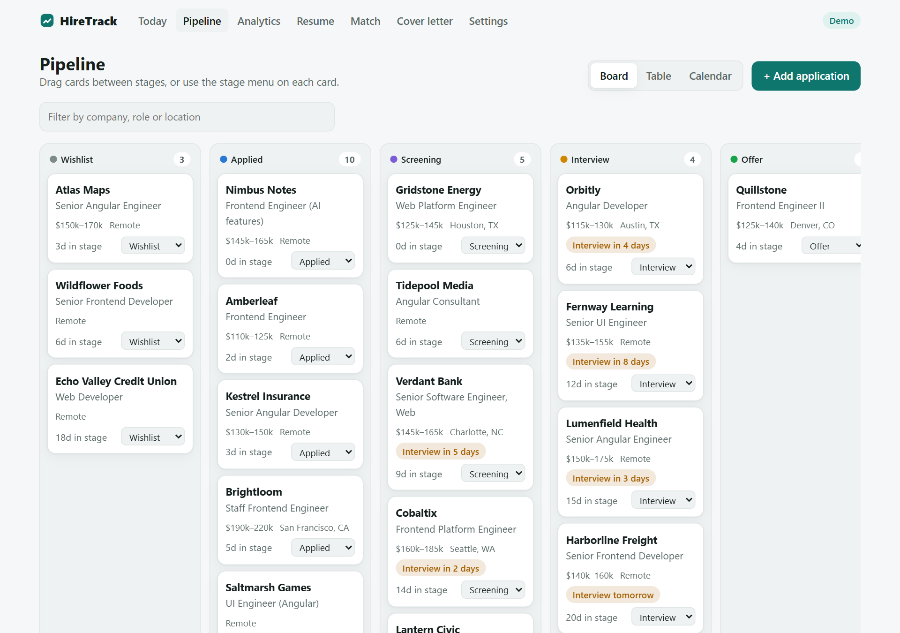
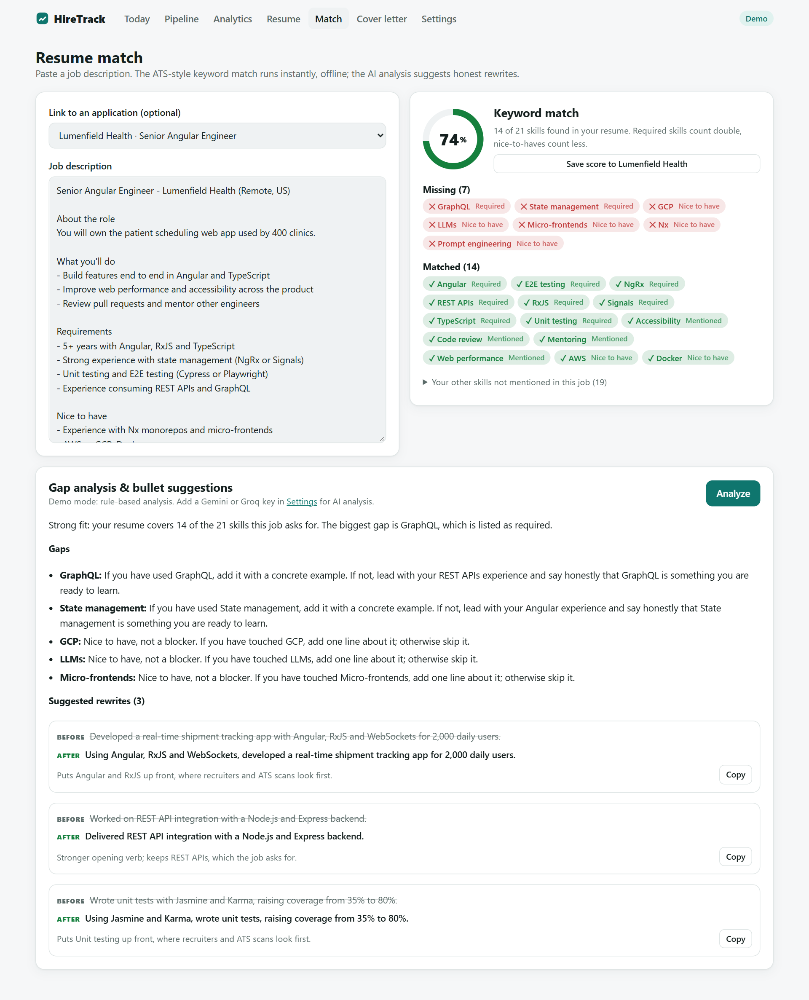
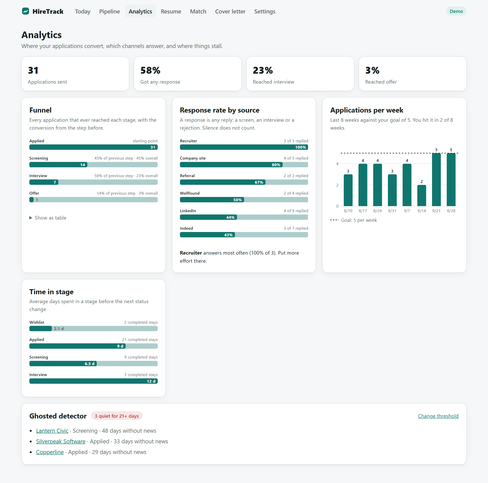
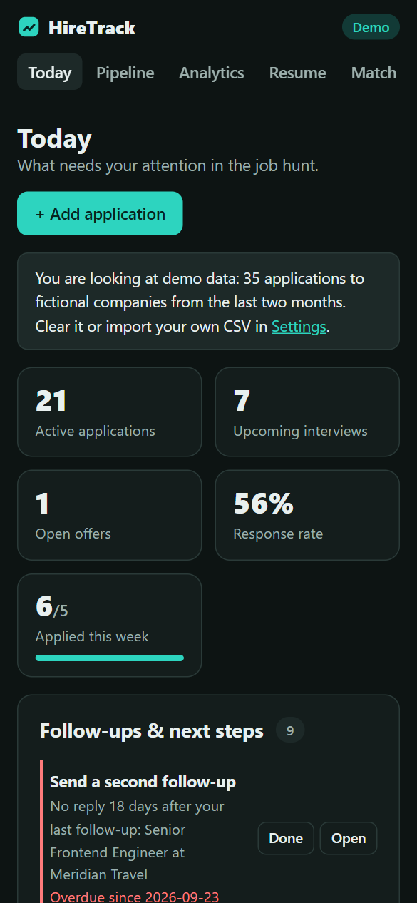
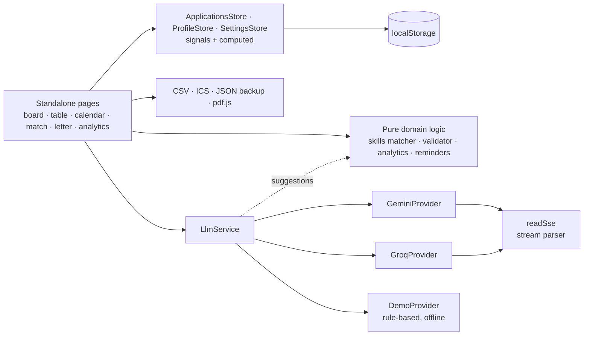

# HireTrack


A job application tracker for people in the middle of a job hunt. Track every application on a drag-and-drop pipeline board, see which job boards actually answer, and get nudged when it is time to follow up. Paste a job description to get an ATS-style keyword match against your resume, AI gap analysis with bullet rewrites that are checked so they never invent experience, and a cover letter that streams in live.

**[▶ Live demo](https://konicamaheshwarii.github.io/job-hunt-dashboard/)**: works instantly in Demo mode with two months of sample data. No key or sign-up needed.



## Features

- **Pipeline board, table and calendar.** Drag cards between wishlist, applied, screening, interview, offer, rejected and ghosted (or use the stage menu on touch and keyboard). A sortable, filterable table and a month calendar of interviews, next actions and follow-ups.
- **Full application records.** Company, role, link, location and work mode, salary range, source, contacts, notes, next action with a due date, interviews, and the date of every status change (editable).
- **Resume parsing.** Paste text or upload a PDF (pdf.js, lazy-loaded, worker served next to the app). The resume becomes a structured profile: contact details, summary, roles with bullets, education and skills.
- **ATS-style keyword match.** A dictionary of about 100 skills with synonyms (`k8s` → Kubernetes, `ReactJS` → React, `Jasmine` → Unit testing) finds what the job asks for. Skills under "Requirements" weigh more than "Nice to have". You get a score, matched and missing skills, and can save the score to the application.
- **Gap analysis and honest bullet rewrites.** The AI suggests how to handle each gap and rephrases existing bullets for the job. Every suggestion is validated before it is shown: rewrites that add a skill or a number not in your resume, or that rewrite a line that is not in it, are removed and listed with the reason.
- **Streaming cover letters.** Formal, friendly or concise. Built from the resume, the job description and the matched skills, told not to claim the missing ones. Edit it, then copy or download as `.txt` or `.md`.
- **Analytics with hand-written SVG charts.** Funnel (applied → screening → interview → offer) with step and overall conversion, response rate by source, average time in each stage, weekly applications against your goal, and a ghosted detector.
- **Reminders.** Follow up N days after applying with no reply, a second follow-up, ask for an update when screening goes quiet, thank-you notes after interviews, prepare before interviews, respond to offers, and your own due next actions. Optional daily browser notification (Notification API, opt-in). Export upcoming interviews as an `.ics` calendar file.
- **Your data stays yours.** Everything lives in localStorage. CSV import/export (also reads spreadsheets from other trackers with headers like "Company Name", "Position", "Date Applied") and JSON backup/restore. Backups never contain API keys.
- **Bring your own key, or none.** Google Gemini or Groq, called straight from the browser. Demo mode is the default: rule-based gap analysis and template cover letters, so every feature works offline.
- **Light/dark themes, mobile layout down to 390px, keyboard and screen-reader friendly.**

| Resume match | Analytics | Mobile, dark |
|---|---|---|
|  |  |  |

## Architecture



- **Deterministic first, AI second.** The keyword match, analytics, reminders and the ghosted detector are pure functions with no AI involved, so they are instant, free and testable. The LLM only writes prose: gap advice, rewrites and letters.
- **Never trust a rewrite.** `validateSuggestions` re-extracts skills and figures from each AI suggestion and compares them with the resume. Anything new is dropped and shown with the reason. The demo provider's own suggestions go through the same check.
- **Skill extraction that handles real text.** Longest phrase wins ("React Native" is not also "React"), word boundaries respect `C#`, `C++`, `.NET` and "Node.js." at the end of a sentence, and words that are also plain English (REST, Go, Swift, SOLID) only match in their technical spelling.
- **Signals all the way down.** State lives in signal stores with `computed` views. The app runs zoneless with `OnPush` components and lazy-loaded routes (about 76 kB initial transfer; pdf.js loads only when you upload a PDF).
- **Provider abstraction.** One `LlmProvider` interface (`complete` + `stream`) with Gemini, Groq and Demo implementations, chosen at runtime. Requests carry an `AbortSignal`, so leaving a page cancels them.
- **Prompt-injection hygiene.** The resume and job description are fenced in tags and treated as data. Replies are parsed defensively (code fences, prose and `<think>` tags stripped, incomplete items dropped).
- **Charts without a chart library.** Bars and columns are hand-written SVG that measure their container, so text stays readable on phones. Each mark has a hover title and keyboard focus; the funnel has a table view.

```
src/app
├── core
│   ├── skills/        dictionary + synonyms, extractor, match score, suggestion validator
│   ├── resume/        text parser, pdf.js extraction
│   ├── io/            CSV, ICS, JSON backup
│   ├── llm/           provider interface, Gemini, Groq, Demo, SSE reader
│   ├── analytics.ts   funnel, response rates, time in stage, weekly counts, ghosted detector
│   ├── reminders.ts   follow-up rules
│   ├── prompts.ts     prompt builders and response parsers
│   ├── seed.ts        demo pipeline, resume and job description
│   └── *.store.ts     applications, profile, settings
├── features/          dashboard · board · table · calendar · application · analytics · resume · match · letter · settings
└── shared/            SVG charts, pipes, download helpers
```

## Getting started

```bash
npm install
npm start          # http://localhost:4200
npm run test:ci    # unit tests in headless Chrome
npm run build
```

Open **Settings** to switch from Demo to Gemini or Groq and paste a free key:
[Gemini](https://aistudio.google.com/apikey) · [Groq](https://console.groq.com/keys).
The key is stored in your browser and sent only to that provider.

## Testing

58 unit tests cover the logic most likely to break:

- skill extraction: synonyms, longest-phrase matching, word boundaries, case-sensitive terms
- match score: required vs nice-to-have weighting, inline hints, synonyms on the resume side
- the suggestion validator: invented skills, invented numbers, lines not in the resume
- funnel and conversion math, response rate by source, time in stage, weekly buckets, the ghosted detector
- follow-up rules: thresholds, second follow-ups, thank-you notes, next actions, offers, stale wishlist items
- CSV parsing and a full export/import round trip, formula neutralising, foreign headers; ICS escaping, folding and timing
- resume parsing, PDF text joining, prompt fencing, defensive JSON parsing, SSE parsing, the demo provider and the store

CI (GitHub Actions) runs the tests and the production build on every push, then deploys `main` to GitHub Pages.

## License

[MIT](LICENSE)
